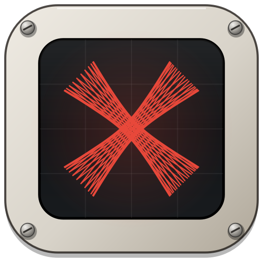

# Xenakis

Chop stems and multitracks into clean, labeled samples for remixing.

## Get the app

Go to **Releases** (right side of this page), download **Xenakis.exe**, and double-click it.
No install needed. The first time, Windows may show "Windows protected your PC": click
**More info → Run anyway**.

## How it works

1. **Load:** type the artist and song, then drop in stems or a whole stem folder.
   Xenakis works out what each file is (kick, hats, drum loops, FX, vocals, guitar...).
   Change any type, or switch a file to Manual, before processing.
   Drop a folder that holds several song folders (named like `Artist - Song`) to queue them up.
2. **Review:** every chop shows up with its waveform. Press play, drag the blue handles to trim,
   change the type from the dropdown, and give it a thumbs up. When everything is green, export.
   - Per chop: fade in / fade out, reverse, gain (turn down from full level), smooth loop seam,
     clone, delete. Drag any row straight into FL Studio.
   - Trim editor: click anywhere to play the stem from that spot (Space stops). Drag the flags
     to trim, or drag the grab bar between them to slide the whole selection at the same length
     (loops stay on the bar grid while Snap is on). Drag across the waveform to pick a new
     section. Scroll to zoom (all the way out to the whole stem), Shift+scroll to move.
     A playhead shows what's playing; loops repeat so you can hear the seam.
   - Per stem: Approve all / Remove all.
   - Drag the grip between the editor and the list to give either one more room. Drag it all
     the way up to hide the editor and see only the list; double-click it to reset. The app
     remembers where you left it.
3. **Export:** all files land in one folder on your Desktop, for example
   `Taylor Swift - Style (Chopped)`, named like `TS_Style_Kick_01.wav`. With a queue, the next
   song loads with one click.

Menu › UI size picks Small, Medium (default) or Large. Everything scales together and the change
applies right away without losing your work. Make the window as small as you like: below a
certain width the layout switches to a compact version, and it never lets controls overlap.

Your work is saved automatically. If the app closes, it offers to pick up where you left off.
Menu › Save session as… / Open session… keep a session as a file (`.xenakis`). Xenakis checks for new
versions when it starts and updates itself with one click.

### Keys on the Review page

| Key | Does |
|---|---|
| ↑ / ↓ | Move through the chops and play each one |
| Space | Play / stop |
| A | Approve and jump to the next chop |
| Enter | Approve / un-approve |
| Delete | Delete the chop |
| Ctrl+D | Clone the chop |
| Ctrl+Z / Ctrl+Y | Undo / redo |
| R | Reverse on / off |
| L | Loop playback on / off |
| S | Snap on / off |

### What it does with each kind of stem

| Stem | What you get |
|---|---|
| Kick, snare, clap, hats, cymbals, toms | Up to 3 distinct hits per sound, tight start, full tail |
| Unlabeled stem with mixed hits | Each hit is sorted by type, up to 3 of each |
| Full drums, drum / perc loops, fills | One loop per distinct groove (2, 4, 8 or 16 bars), every hit chopped out of that loop, rolls kept whole, plus single hits |
| FX | Whooshes, risers, impacts, lasers, air horns, sirens... each event with its full decay |
| Vocals | Shouts, adlibs and phrases; repeats only kept when they sound different |
| Guitar, synth, bass, keys | AI-suggested stabs, chords and 2-bar phrases to approve or fix |

Any file can be opened in **Edit regions** to mark parts by hand.

### Output

- 24-bit WAV at the original sample rate
- Each sample normalized to −0.1 dB
- Very light fade at the edges to remove clicks
- No tempo, key or other tags embedded
- Re-running a song adds to the folder and keeps counting; nothing is overwritten
- The whole song shares one tempo, found from the clearest drum stem
- Split mono files ending in `_L` / `_R` are joined back into stereo when both halves are present

## Plug-in (VST3 + CLAP)

Xenakis also runs inside your DAW. Download **Xenakis-Plugin-Windows.zip** from Releases and
follow `INSTALL.txt` inside it: copy `Xenakis.vst3` into `C:\Program Files\Common Files\VST3`
and/or `Xenakis.clap` into `C:\Program Files\Common Files\CLAP`, then rescan plug-ins.
Load it as an effect on any mixer track, drop in stems, press Process all, review, and drag
samples from the list straight into your project. Chops you audition play through that track.

The plug-in is a C++ (JUCE) rebuild of the same engine, in `plugin/`. It makes exactly the same
chops as the desktop app (checked file-for-file on real stems). Stage 1 covers loading, chopping,
the review list (approve, type, delete, drag out) and export; the trim editor, fades, undo, the
AI sound recognition and saving the session in your DAW project come next.

```
cmake -S plugin -B build && cmake --build build --config Release --target Xenakis_VST3 Xenakis_CLAP
build/.../xk_engine_cli --selftest             # engine check
build/.../xk_engine_cli <stems folder>         # what the C++ engine finds
python plugin/tools/compare_engine.py <folder> # what the Python engine finds (same format)
```

## Sound recognition

File names come first. When a name is unclear or points two ways, a bundled trained model
(CED-mini, AudioSet classes, Apache 2.0, via sherpa-onnx) listens to the stem. The same model labels
FX and vocal events and confirms claps, tambourines, shakers and rimshots.

## For developers

```
pip install -r requirements.txt
python -m multicrack              # run the app
python -m multicrack --selftest   # quick check of the engine and window
python tools/run_stems.py <folder> [--export OUTDIR]   # print what the engine finds
```

Every push to `main` builds `Xenakis.exe` on Windows, self-tests it, and publishes it as a release.

## Name and logo

Named for Iannis Xenakis, the composer and architect who built music and buildings out of straight
lines (string glissandi in *Metastaseis*, the ruled surfaces of the Philips Pavilion). The logo's X is
made the same way: two bands of straight lines whose crossings form the curves.

The app was called MultiCrack before. Settings, the autosave and `.multicrack` session files carry
over, and copies of MultiCrack.exe update straight to Xenakis. The Python package is still named
`multicrack`.
